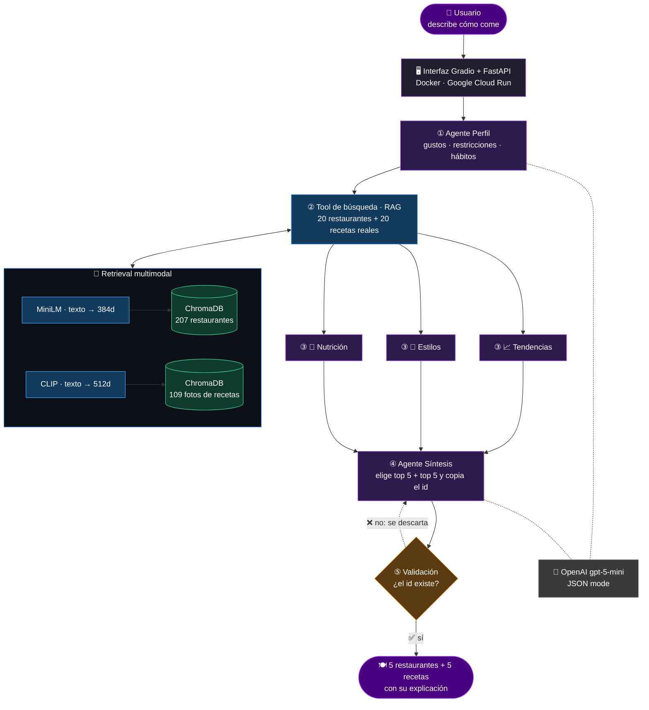

# 🍽️ FRS - Food Recommendation System (Plate Picker)

  

## Que es?

Recomienda restaurantes y recetas utilizando **RAG multimodal** (texto e imagen) y un **sistema multi-agente con LangGraph**.

## Que hace?

Introduces los hábitos alimentarios de una persona (historial de restaurantes, publicaciones, restricciones…) y el sistema devuelve **5 restaurantes y 5 recetas que existen en la base de datos** y encajan con sus gustos y su perfil alimentario, explicando el por qué de esa decisión.

---

## 📊 Evaluación de resultados

| Métrica | Valor |
|:--|:--:|
| hit@5 | **0.89** |
| MRR | **0.74** |
| latencia | **18.7ms** |

---

## 🗺️ Cómo funciona

### 📚 Conceptos clave

| Concepto | Qué es | Dónde se usa en FRS |
|:--|:--|:--|
| **Embedding** | Convertir un texto o una imagen en una lista de números que representa su significado | MiniLM (texto, 384d) y CLIP (texto ↔ imagen, 512d) |
| **Vector DB** | Base de datos que encuentra "lo más parecido a esto" comparando vectores | ChromaDB, 2 colecciones |
| **RAG** | El LLM responde con datos reales que se buscan antes, no con lo que "recuerda" | Paso ② da al agente candidatos reales |
| **Multimodal** | Buscar en texto e imágenes a la vez | "pizza con albahaca" encuentra la foto de una margarita |
| **Agente** | Un LLM con un rol, un objetivo y un contexto concretos | Perfil, Tendencias, Estilos, Nutrición, Síntesis |
| **State** | La "libreta" compartida que cada agente lee y completa | `WorkflowState` de LangGraph |
| **Fan-out / fan-in** | Lanzar varios agentes a la vez y juntar sus resultados | Paso ③ en paralelo → paso ④ |
| **Tool** | Una función real que el agente usa en vez de inventarse la respuesta | Búsqueda en ChromaDB |
| **Validación** | Comprobar en código lo que dice el LLM | `keep_valid()` descarta ids inventados → 0 alucinaciones |
| **JSON mode** | Obligar al LLM a responder en JSON válido | Evita respuestas rotas |
| **Docker + Cloud Run** | Empaquetar la app en un contenedor y ejecutarla en la nube bajo demanda | Demo pública |

---

## 🧩 Estructura del Sistema

| Componente | Tecnología | Función |
|:--|:--|:--|
| Embedding de texto | `all-MiniLM-L6-V2` | Convierte cada restaurante en un vector |
| Embedding de imagen | `CLIP` (512d) | Para buscar fotos de recetas escribiendo texto |
| VectorDB | `ChromaDB` | Para buscar por similitud vectorial |
| Agentes | `LangGraph` | Para coordinar los agentes con un state compartido |
| LLM | `OpenAI` (gpt-5-mini) | Perfil, análisis y síntesis |
| API | `FastAPI` | Endpoint `/recommend` |
| Interfaz | `Gradio` | Demo web con la estética de Loading SSG |
| Despliegue | `Docker` + `Google Cloud Run` | Demo pública en la nube |

  

---

## 🚀 Pruébalo

  

> ⏱️ La primera visita puede tardar ~30 s en arrancar (el servidor se apaga cuando no se usa). Cada recomendación tarda ~30 s: trabajan 5 agentes.

---

## ✅ Hecho / 🔜 Siguiente

- [x] Retrieval multimodal evaluado con golden set (hit@5 0.89, MRR 0.74)
- [x] Sin alucinaciones: tool real contra ChromaDB + validación de ids (10/10 recomendaciones reales)
- [x] API con FastAPI
- [x] Interfaz web con Gradio
- [x] Despliegue en Google Cloud Run con Docker
- [ ] Servidor MCP para usar FRS desde cualquier asistente de IA
- [ ] Restricciones alimentarias como filtro obligatorio
- [ ] Embeddings multilingües (mejorar las consultas en español)
